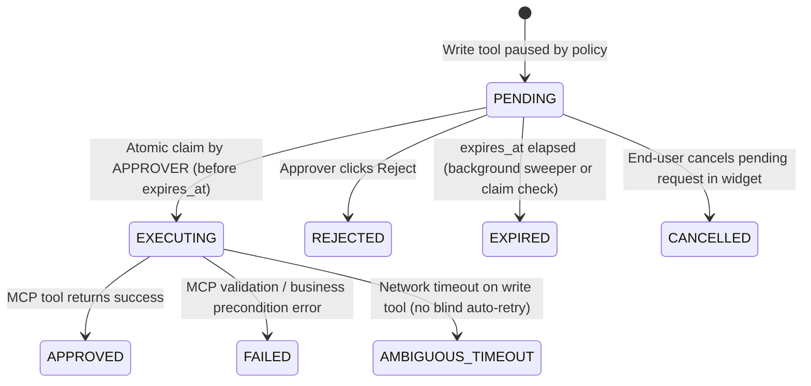

# 04 — Runtime Conversations, Ordered Messages, Tool Executions & HITL Approvals

**Tables:** `conversations`, `messages`, `tool_executions`, `approvals`  
**Blueprint Alignment:** Sections 6, 7, 8, 9, 12, 13, 14 · FixJi Workflow Steps 5, 6 & 7 · Prototype Page 14

---

## Design Decisions

1. **Playground Before First Publish (`pinned_version_id` Nullability):**
   - Blueprint Section 14 requires `Draft v4 -> Validate -> Playground test -> Publish v4`. A brand-new agent has **no** `agent_versions` row yet during Playground testing.
   - Therefore, `conversations` stores `agent_id` (always `NOT NULL`) and `pinned_version_id` (`NOT NULL` for `WIDGET` / `API`, nullable for `PLAYGROUND` dry-run testing).
2. **Session Hijack Protection (`UUID` + `visitor_token_hash`):**
   - Public widget chats cannot rely on sequential IDs like `conv_7121`. `conversations.id` is a random `UUID`, paired with a SHA-256 `visitor_token_hash` checked on every follow-up turn. A friendly `display_code` (e.g., `conv_7121`) is kept strictly for Dashboard UI display.
3. **Protocol-Faithful LLM Replay (`messages.sequence_no`, `tool_calls`, `tool_call_id`):**
   - OpenAI, Gemini, and LangGraph reject malformed history if `TOOL` outputs lack a matching preceding `ASSISTANT` `tool_calls` message. Strict `sequence_no` + `visibility` (`PUBLIC` vs `INTERNAL`) keeps LLM replay valid without exposing raw backend payloads to the widget UI.
4. **Atomic HITL Pause-and-Resume (`approvals` + `tool_executions`):**
   - `approvals` persists **everything** a stateless worker needs hours later to resume: `agent_version_id`, `mcp_server_id`, `mcp_tool_id`, `tool_execution_id`, `llm_tool_call_id`, frozen `proposed_arguments`, `expires_at`, and `idempotency_key`.
   - Dual-click / concurrent-approver races are eliminated via a single atomic `UPDATE ... WHERE status = 'PENDING' AND expires_at > NOW()` transition into `EXECUTING`.

---

## HITL Approval State Machine



---

## 1. `conversations`

Tracks widget visitor chats and internal playground test sessions, pinning the published version for the entire lifetime of a live chat.

```sql
CREATE TABLE conversations (
    id                 UUID PRIMARY KEY DEFAULT gen_random_uuid(),
    tenant_id          VARCHAR(50) NOT NULL REFERENCES tenants(id) ON DELETE CASCADE,
    display_code       VARCHAR(30) NOT NULL,
    channel            VARCHAR(20) NOT NULL CHECK (channel IN ('WIDGET', 'PLAYGROUND', 'API')),
    deployment_id      VARCHAR(50),
    agent_id           VARCHAR(50) NOT NULL,
    pinned_version_id  VARCHAR(50),
    visitor_token_hash VARCHAR(64),
    created_by_user_id UUID REFERENCES users(id),
    status             VARCHAR(30) NOT NULL DEFAULT 'ACTIVE'
                       CHECK (status IN ('ACTIVE', 'WAITING_FOR_APPROVAL', 'CLOSED')),
    metadata           JSONB NOT NULL DEFAULT '{}'::jsonb,
    created_at         TIMESTAMPTZ NOT NULL DEFAULT NOW(),
    updated_at         TIMESTAMPTZ NOT NULL DEFAULT NOW(),
    UNIQUE (tenant_id, id),
    UNIQUE (tenant_id, display_code),
    FOREIGN KEY (tenant_id, agent_id) REFERENCES agents(tenant_id, id) ON DELETE CASCADE,
    FOREIGN KEY (tenant_id, deployment_id) REFERENCES deployments(tenant_id, id),
    FOREIGN KEY (tenant_id, agent_id, pinned_version_id)
        REFERENCES agent_versions(tenant_id, agent_id, id),
    CHECK (
        (channel = 'WIDGET' AND deployment_id IS NOT NULL AND pinned_version_id IS NOT NULL AND visitor_token_hash IS NOT NULL)
        OR channel IN ('PLAYGROUND', 'API')
    )
);

CREATE INDEX idx_conversations_tenant_recent ON conversations(tenant_id, updated_at DESC);
CREATE INDEX idx_conversations_waiting ON conversations(tenant_id, status) WHERE status = 'WAITING_FOR_APPROVAL';

CREATE TRIGGER trg_conversations_updated_at
    BEFORE UPDATE ON conversations
    FOR EACH ROW EXECUTE FUNCTION set_updated_at();
```

---

## 2. `messages`

Ordered turn-by-turn history supporting user text, assistant text, assistant `tool_calls`, and `TOOL` outputs.

```sql
CREATE TABLE messages (
    id              UUID PRIMARY KEY DEFAULT gen_random_uuid(),
    tenant_id       VARCHAR(50) NOT NULL REFERENCES tenants(id) ON DELETE CASCADE,
    conversation_id UUID NOT NULL,
    sequence_no     INT NOT NULL CHECK (sequence_no > 0),
    sender_role     VARCHAR(20) NOT NULL CHECK (sender_role IN ('SYSTEM', 'USER', 'ASSISTANT', 'TOOL')),
    visibility      VARCHAR(20) NOT NULL DEFAULT 'PUBLIC' CHECK (visibility IN ('PUBLIC', 'INTERNAL')),
    content         TEXT,
    tool_calls      JSONB,
    tool_call_id    VARCHAR(150),
    metadata        JSONB NOT NULL DEFAULT '{}'::jsonb,
    created_at      TIMESTAMPTZ NOT NULL DEFAULT NOW(),
    UNIQUE (tenant_id, id),
    UNIQUE (conversation_id, sequence_no),
    FOREIGN KEY (tenant_id, conversation_id) REFERENCES conversations(tenant_id, id) ON DELETE CASCADE,
    CHECK (sender_role <> 'TOOL' OR tool_call_id IS NOT NULL)
);

CREATE INDEX idx_messages_widget_poll ON messages(conversation_id, visibility, sequence_no)
    WHERE visibility = 'PUBLIC';
```

### Example Turn Sequence (Step 5 + Step 6 + Step 7)

| `sequence_no` | `sender_role` | `visibility` | `tool_calls` / `tool_call_id` | `content` |
| --- | --- | --- | --- | --- |
| 1 | `USER` | `PUBLIC` | `NULL` | `"Nellore lo repu 10 AM ki House Painting available unda?"` |
| 2 | `ASSISTANT` | `INTERNAL` | `[{"id":"call_1","name":"check_availability","args":{...}}]` | `NULL` |
| 3 | `TOOL` | `INTERNAL` | `tool_call_id: "call_1"` | `'{"available": true, "technician": "Ravi"}'` |
| 4 | `ASSISTANT` | `PUBLIC` | `NULL` | `"Technician Ravi is available tomorrow at 10 AM. Shall I book?"` |
| 5 | `USER` | `PUBLIC` | `NULL` | `"Yes, please book it."` |
| 6 | `ASSISTANT` | `INTERNAL` | `[{"id":"call_2","name":"create_booking","args":{...}}]` | `NULL` |
| 7 | `ASSISTANT` | `PUBLIC` | `NULL` | `"Booking request BK-2048 sent to FixJi team for approval."` |
| 8 *(Step 7)* | `TOOL` | `INTERNAL` | `tool_call_id: "call_2"` | `'{"booking_id": "FXJ-999", "status": "CONFIRMED"}'` |
| 9 *(Step 7)* | `ASSISTANT` | `PUBLIC` | `NULL` | `"Your House Painting booking in Nellore is confirmed (FXJ-999)."` |

---

## 3. `tool_executions`

Full execution audit & latency trace for every read and write MCP call (Blueprint Sections 5.7, 12, 17).

```sql
CREATE TABLE tool_executions (
    id               UUID PRIMARY KEY DEFAULT gen_random_uuid(),
    tenant_id        VARCHAR(50) NOT NULL REFERENCES tenants(id) ON DELETE CASCADE,
    conversation_id  UUID NOT NULL,
    agent_version_id VARCHAR(50),
    mcp_server_id    VARCHAR(50) NOT NULL,
    mcp_tool_id      VARCHAR(50) NOT NULL,
    tool_name        VARCHAR(150) NOT NULL,
    llm_tool_call_id VARCHAR(150) NOT NULL,
    input_arguments  JSONB NOT NULL,
    output_payload   JSONB,
    status           VARCHAR(30) NOT NULL
                     CHECK (status IN (
                         'STARTED', 'WAITING_APPROVAL', 'EXECUTING',
                         'SUCCESS', 'FAILED', 'TIMEOUT', 'AMBIGUOUS_TIMEOUT',
                         'SCHEMA_MISMATCH', 'POLICY_DENIED', 'REJECTED', 'EXPIRED', 'CANCELLED'
                     )),
    is_dry_run       BOOLEAN NOT NULL DEFAULT FALSE,
    error_code       VARCHAR(100),
    error_message    TEXT,
    latency_ms       INT CHECK (latency_ms IS NULL OR latency_ms >= 0),
    created_at       TIMESTAMPTZ NOT NULL DEFAULT NOW(),
    completed_at     TIMESTAMPTZ,
    UNIQUE (tenant_id, id),
    FOREIGN KEY (tenant_id, conversation_id) REFERENCES conversations(tenant_id, id) ON DELETE CASCADE,
    FOREIGN KEY (tenant_id, agent_version_id) REFERENCES agent_versions(tenant_id, id),
    FOREIGN KEY (tenant_id, mcp_server_id) REFERENCES mcp_servers(tenant_id, id),
    FOREIGN KEY (tenant_id, mcp_tool_id) REFERENCES mcp_tools(tenant_id, id),
    CHECK (is_dry_run = TRUE OR agent_version_id IS NOT NULL)
);

CREATE INDEX idx_tool_exec_tenant_time ON tool_executions(tenant_id, created_at DESC);
CREATE INDEX idx_tool_exec_conv ON tool_executions(conversation_id, created_at);
```

---

## 4. `approvals`

Human-in-the-loop gate holding every piece of state needed for safe, idempotent, single-execution resumption.

```sql
CREATE TABLE approvals (
    id                 UUID PRIMARY KEY DEFAULT gen_random_uuid(),
    tenant_id          VARCHAR(50) NOT NULL REFERENCES tenants(id) ON DELETE CASCADE,
    display_ref        VARCHAR(30) NOT NULL,            -- e.g. 'BK-2048'
    conversation_id    UUID NOT NULL,
    agent_version_id   VARCHAR(50),
    tool_execution_id  UUID NOT NULL,
    mcp_server_id      VARCHAR(50) NOT NULL,
    mcp_tool_id        VARCHAR(50) NOT NULL,
    tool_name          VARCHAR(150) NOT NULL,
    llm_tool_call_id   VARCHAR(150) NOT NULL,
    proposed_arguments JSONB NOT NULL,
    ui_summary         JSONB NOT NULL DEFAULT '{}'::jsonb,
    status             VARCHAR(25) NOT NULL DEFAULT 'PENDING'
                       CHECK (status IN ('PENDING', 'EXECUTING', 'APPROVED', 'REJECTED', 'FAILED', 'AMBIGUOUS_TIMEOUT', 'EXPIRED', 'CANCELLED')),
    is_sandbox         BOOLEAN NOT NULL DEFAULT FALSE,
    idempotency_key    VARCHAR(255) UNIQUE NOT NULL,
    expires_at         TIMESTAMPTZ NOT NULL,
    decided_by_user_id UUID REFERENCES users(id),
    decision_reason    TEXT,
    decided_at         TIMESTAMPTZ,
    created_at         TIMESTAMPTZ NOT NULL DEFAULT NOW(),
    updated_at         TIMESTAMPTZ NOT NULL DEFAULT NOW(),
    UNIQUE (tenant_id, id),
    UNIQUE (tenant_id, display_ref),
    UNIQUE (tool_execution_id),
    FOREIGN KEY (tenant_id, conversation_id) REFERENCES conversations(tenant_id, id) ON DELETE CASCADE,
    FOREIGN KEY (tenant_id, agent_version_id) REFERENCES agent_versions(tenant_id, id),
    FOREIGN KEY (tenant_id, tool_execution_id) REFERENCES tool_executions(tenant_id, id) ON DELETE CASCADE,
    FOREIGN KEY (tenant_id, mcp_server_id) REFERENCES mcp_servers(tenant_id, id),
    FOREIGN KEY (tenant_id, mcp_tool_id) REFERENCES mcp_tools(tenant_id, id),
    CHECK (is_sandbox = TRUE OR agent_version_id IS NOT NULL),
    CHECK (
        status IN ('PENDING', 'EXPIRED', 'CANCELLED')
        OR (decided_by_user_id IS NOT NULL AND decided_at IS NOT NULL)
    )
);

CREATE INDEX idx_approvals_pending_queue ON approvals(tenant_id, status, expires_at)
    WHERE status = 'PENDING';

CREATE TRIGGER trg_approvals_updated_at
    BEFORE UPDATE ON approvals
    FOR EACH ROW EXECUTE FUNCTION set_updated_at();
```

### Atomic Approval Claim Query (Eliminates Double-Click / Dual-Approver Races)

```sql
-- Executed inside transaction after confirming current user holds APPROVER/ADMIN/OWNER in tenant_members
UPDATE approvals
SET status = 'EXECUTING',
    decided_by_user_id = :approver_user_id,
    decided_at = NOW()
WHERE id = :approval_id
  AND tenant_id = :tenant_id
  AND status = 'PENDING'
  AND expires_at > NOW()
RETURNING *;
```

- If **1 row returned**: this worker exclusively owns executing `mcp_tool_id` using `idempotency_key` after revalidating business preconditions.
- If **0 rows returned**: return `409 Conflict` (already claimed, decided, cancelled, or expired)—no duplicate booking can ever occur.

**Example Row (`BK-2048`):**
```json
{
  "id": "550e8400-e29b-41d4-a716-446655440000",
  "tenant_id": "tnt_fixji_001",
  "display_ref": "BK-2048",
  "conversation_id": "7f9c2d10-3a44-4c5b-9f10-8a7b6c5d4e3f",
  "agent_version_id": "ver_v1_2",
  "tool_execution_id": "9a1b2c3d-4e5f-6789-abcd-ef0123456789",
  "mcp_server_id": "srv_01",
  "mcp_tool_id": "tl_3",
  "tool_name": "create_booking",
  "llm_tool_call_id": "call_2",
  "proposed_arguments": {
    "service": "House painting",
    "area": "Nellore",
    "time": "Tomorrow - 10 AM"
  },
  "ui_summary": {
    "Service": "House painting",
    "Area": "Nellore",
    "Requested time": "Tomorrow · 10 AM"
  },
  "status": "PENDING",
  "is_sandbox": false,
  "idempotency_key": "idem_7f9c2d10_call_2",
  "expires_at": "2026-11-09T10:17:05Z"
}
```
