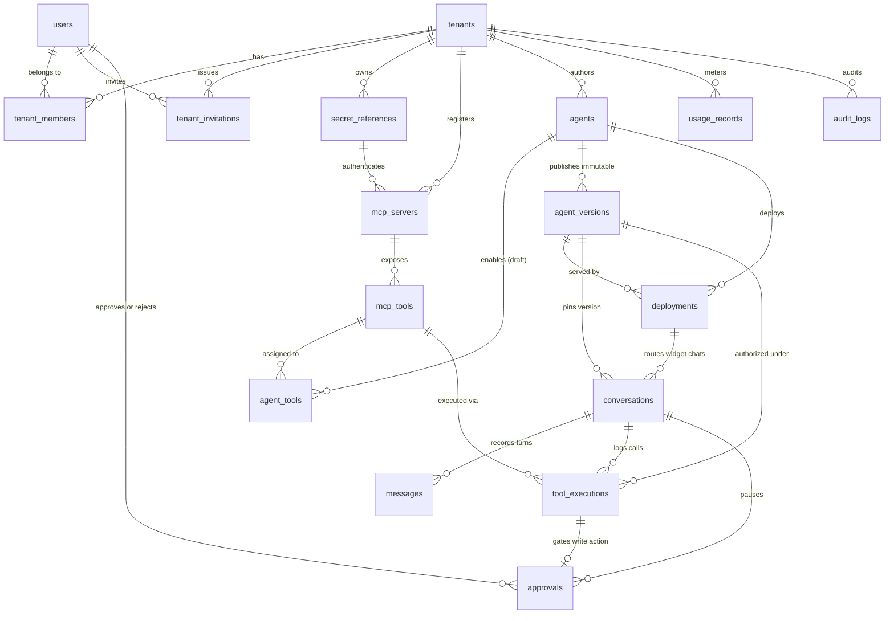

# RelayAI — Production PostgreSQL Database Architecture

This directory contains the production-hardened PostgreSQL (16+) schema design for **RelayAI**, expanding the initial 12-table workflow draft with every operational table and reliability invariant required by the **RelayAI Product & Technical Blueprint (v1.0)**:

- **4 Requested Expansion Tables:** `tool_executions`, `audit_logs`, `usage_records`, `tenant_invitations`
- **1 Relational Integrity Upgrade (Blueprint Section 12):** `agent_tools` (replaces untyped JSONB string arrays on mutable agent drafts with composite foreign-key-enforced bindings, while `agent_versions.published_config` remains a self-contained immutable JSONB snapshot)
- **Structural Multi-Tenant Isolation:** Composite `(tenant_id, id)` foreign keys across all tenant-owned tables + **PostgreSQL Row-Level Security (RLS)** (`FORCE ROW LEVEL SECURITY`)
- **Production HITL Resume Guarantees:** `agent_version_id`, `mcp_tool_id`, `tool_execution_id`, `llm_tool_call_id`, `expires_at`, atomic `PENDING -> EXECUTING -> APPROVED/FAILED` locking, `idempotency_key`, and `decided_at`/`decision_reason`

> **Tech-Stack Agnostic:** These schemas are pure PostgreSQL DDL and SQL patterns. Whether the Control Plane and Runtime are implemented in FastAPI/LangGraph, .NET 10, or a hybrid split, the database invariants remain identical.

---

## Document Index

| File | Scope | Tables Covered |
| --- | --- | --- |
| [01-tenancy-and-identity.md](./01-tenancy-and-identity.md) | Organizations, accounts, RBAC, email invitations | `tenants`, `users`, `tenant_members`, `tenant_invitations` |
| [02-mcp-secrets-and-tools.md](./02-mcp-secrets-and-tools.md) | Vault references, external MCP endpoints, tool catalogue | `secret_references`, `mcp_servers`, `mcp_tools` |
| [03-agents-versions-and-deployments.md](./03-agents-versions-and-deployments.md) | Draft studio, relational tool bindings, immutable snapshots, widget routing | `agents`, `agent_tools`, `agent_versions`, `deployments` |
| [04-runtime-conversations-and-hitl.md](./04-runtime-conversations-and-hitl.md) | Chat sessions, ordered LLM replay, tool trace log, HITL state machine | `conversations`, `messages`, `tool_executions`, `approvals` |
| [05-observability-metering-and-audit.md](./05-observability-metering-and-audit.md) | Token/cost telemetry, quota analytics, immutable audit log | `usage_records`, `audit_logs` |
| [06-rls-security-and-bootstrap.md](./06-rls-security-and-bootstrap.md) | DB roles, RLS policies, `SECURITY DEFINER` deployment/auth bootstrap, isolation tests | All tenant-scoped tables |
| [07-complete-schema.sql.md](./07-complete-schema.sql.md) | Single consolidated topological DDL script + FixJi validation seed | Full schema (17 tables) |

---

## Entity-Relationship Diagram

---

## Complete Table Inventory (17 Tables)

| # | Table | Domain | RLS Protected | Tenant Composite FK Key |
| --- | --- | --- | --- | --- |
| 1 | `tenants` | Tenancy | Yes (`id = current_tenant`) | `id` (root) |
| 2 | `users` | Identity | Global (auth/self scoped) | N/A (users can belong to multiple tenants) |
| 3 | `tenant_members` | Tenancy / RBAC | Yes | `UNIQUE (tenant_id, id)` |
| 4 | `tenant_invitations` | Tenancy / Onboarding | Yes | `UNIQUE (tenant_id, id)` |
| 5 | `secret_references` | Secrets | Yes | `UNIQUE (tenant_id, id)` |
| 6 | `mcp_servers` | MCP Registry | Yes | `UNIQUE (tenant_id, id)` |
| 7 | `mcp_tools` | Tool Catalogue | Yes | `UNIQUE (tenant_id, id)` |
| 8 | `agents` | Agent Studio (Draft) | Yes | `UNIQUE (tenant_id, id)` |
| 9 | `agent_tools` | Draft Tool Bindings | Yes | `UNIQUE (tenant_id, id)` |
| 10 | `agent_versions` | Published Snapshots | Yes (Immutable) | `UNIQUE (tenant_id, id)`, `UNIQUE (tenant_id, agent_id, id)` |
| 11 | `deployments` | Public Routing & Origins | Yes (Bootstrap via `SECURITY DEFINER`) | `UNIQUE (tenant_id, id)` |
| 12 | `conversations` | Runtime Sessions | Yes | `UNIQUE (tenant_id, id)` |
| 13 | `messages` | Runtime Chat History | Yes | `UNIQUE (tenant_id, id)` |
| 14 | `tool_executions` | Runtime Tool Telemetry | Yes | `UNIQUE (tenant_id, id)` |
| 15 | `approvals` | HITL Queue | Yes | `UNIQUE (tenant_id, id)` |
| 16 | `usage_records` | Cost & Token Metering | Yes | `tenant_id` indexed |
| 17 | `audit_logs` | Security & Change Trail | Yes (Append-only) | `tenant_id` nullable for platform-level events |

---

## Core Architectural Invariants Enforced by the Schema

1. **Cross-Tenant Linking Is Impossible at the DB Layer:**
   Every tenant-owned child table carries `tenant_id` and declares a composite foreign key such as `FOREIGN KEY (tenant_id, mcp_server_id) REFERENCES mcp_servers(tenant_id, id)`. Even if application code has a bug passing a foreign tenant's `mcp_server_id`, `agent_version_id`, or `conversation_id`, PostgreSQL rejects the `INSERT`/`UPDATE`.
2. **Nullable Composite FKs Use `MATCH SIMPLE` Deliberately:**
   - `conversations.(tenant_id, deployment_id)`: `deployment_id` is `NULL` for internal **Playground** conversations (`channel = 'PLAYGROUND'`) and `NOT NULL` for **Widget** conversations (`channel = 'WIDGET'`).
   - `deployments.(tenant_id, agent_id, previous_version_id)`: `previous_version_id` is `NULL` on initial deployment and populated on subsequent publishes/rollbacks.
   - `mcp_servers.(tenant_id, secret_ref_id)`: `secret_ref_id` is `NULL` only when `auth_type = 'NONE'`, enforced by a `CHECK` constraint.
3. **Database-Enforced Immutability:**
   `BEFORE UPDATE OR DELETE` triggers block modifications to `agent_versions` (protecting pinned conversations and rollback targets) and `audit_logs` (protecting compliance/forensic history).
4. **No Secret Material in PostgreSQL:**
   `secret_references` stores only the Azure Key Vault secret name/URI (`key_vault_secret_name`, `secret_version`). Raw API keys and MCP tokens never enter PostgreSQL, agent prompts, or browser payloads.
5. **Session Hijack Prevention:**
   `conversations.id` is a random `UUID` paired with `visitor_token_hash` (SHA-256 of an opaque visitor token stored in the widget browser), preventing enumeration of sessions like `conv_7121` -> `conv_7122`.

---

## FixJi Workflow Traceability (Steps 1–7)

| Workflow Step | Primary Reads (`SELECT`) | Primary Writes (`INSERT` / `UPDATE`) |
| --- | --- | --- |
| **1A. Admin Creates Tenant** | — | `tenants`, `users`, `tenant_members`, `tenant_invitations`, `audit_logs` |
| **1B. Founder Invites Dev & Approver** | `tenant_members` (verify `OWNER`/`ADMIN`) | `tenant_invitations`, `audit_logs` -> on accept: `users`, `tenant_members` |
| **2. Developer Connects MCP & Discovers Tools** | `tenant_members` (verify `DEVELOPER`+) | `secret_references`, `mcp_servers`, `mcp_tools`, `audit_logs` |
| **3. Admin Authors Draft & Assigns Tools** | `mcp_tools` (active tools for tenant) | `agents`, `agent_tools` |
| **4A. Admin Publishes Version `v1.2`** | `agents`, `agent_tools`, `mcp_tools`, `mcp_servers` | `agent_versions` (frozen `published_config`), `agents.latest_published_version_id`, `audit_logs` |
| **4B. Admin Configures Website Deployment** | `agent_versions` | `deployments`, `audit_logs` |
| **5. Customer Checks Availability (Read Tool)** | `resolve_active_deployment(public_key)`, `agent_versions`, `mcp_servers`, `secret_references` | `conversations` (pins `pinned_version_id`), `messages` (`USER`, `ASSISTANT`, `TOOL`, `ASSISTANT`), `tool_executions`, `usage_records` |
| **6. Customer Requests Booking (HITL Pause)** | `conversations`, `messages`, `agent_versions` | `tool_executions` (`WAITING_APPROVAL`), `approvals` (`PENDING`, `expires_at`, `idempotency_key`), `conversations` (`WAITING_FOR_APPROVAL`), `messages` |
| **7. Approver Clicks "Approve & Resume"** | `tenant_members` (`APPROVER`+), `approvals`, `mcp_servers`, `secret_references`, `messages` | `approvals` (`PENDING -> EXECUTING -> APPROVED`), `tool_executions` (`SUCCESS`), `messages` (`TOOL` + `msg_5`), `conversations` (`ACTIVE`), `usage_records`, `audit_logs` |
